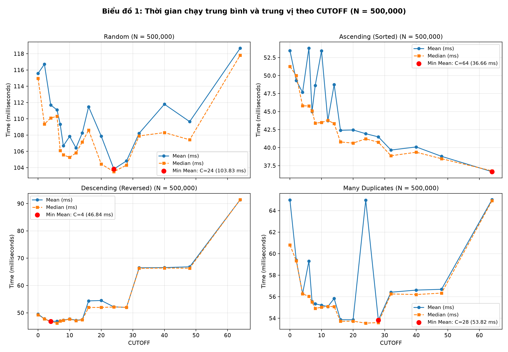
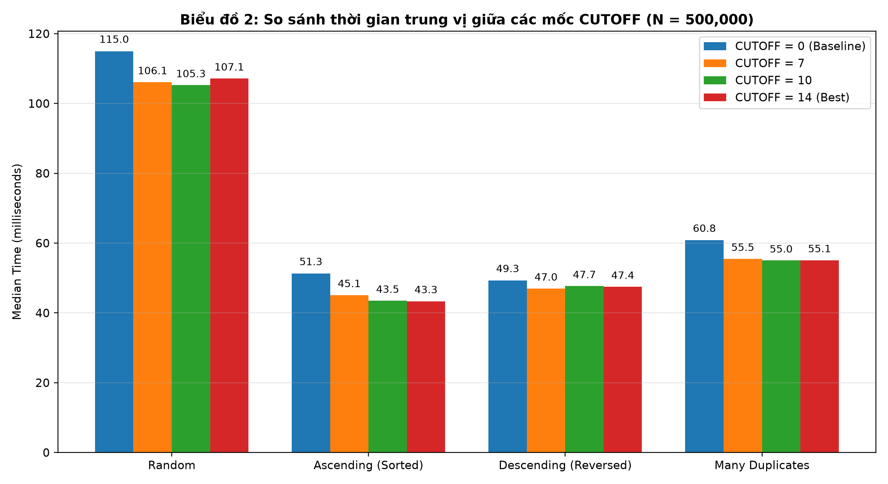
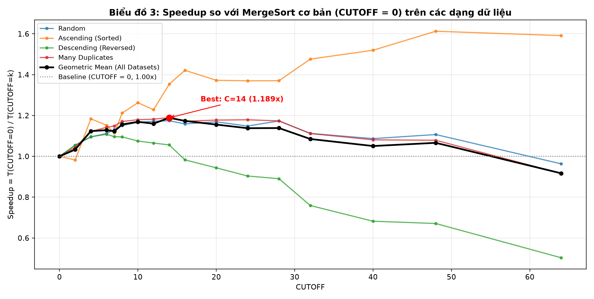
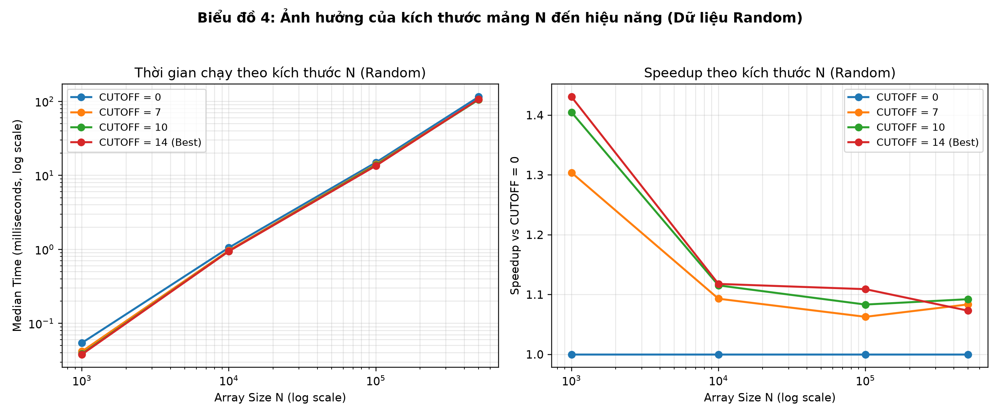
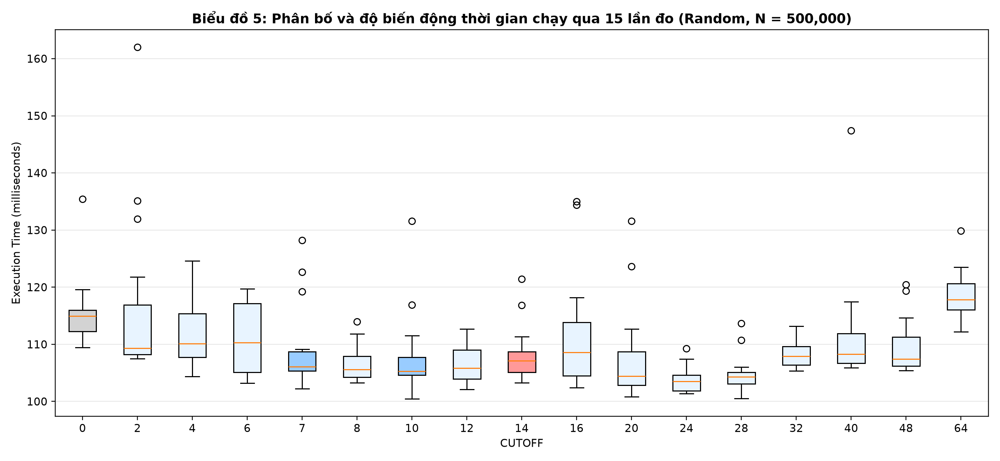

# MergeSort CUTOFF — Experimental Benchmark & Analysis (Java)

     

- **Họ và tên:** Bùi Ngọc Sơn
- **Mã sinh viên:** 25021967
- **Lớp:** K70I-CS2
- **Học phần:** 2627I_UET.CS1058_9

Nghiên cứu thực nghiệm tìm giá trị `CUTOFF` tối ưu (ngưỡng chuyển sang **Insertion Sort** cho mảng con kích thước nhỏ) trong thuật toán **MergeSort** xây dựng bằng Java đúng theo giáo trình *Algorithms, 4th Edition* (`src/Merge.java` và `src/Insertion.java`), đồng thời kiểm chứng hai mốc kinh điển `CUTOFF = 7` (Java 6 / giáo trình cũ) và `CUTOFF = 10` (giáo trình mới).

---

## 1. Thiết kế & Môi trường thí nghiệm

### Cấu hình máy thực nghiệm (`results/machine.txt`)
- **Hệ điều hành:** Microsoft Windows 11 Home 10.0.26300 (64-bit)
- **CPU:** AMD Ryzen 7 H 255 w/ Radeon 780M Graphics (8 cores, 16 logical processors, 3801 MHz)
- **RAM:** 15.31 GB
- **Java Runtime:** `openjdk version "17.0.18" 2026-01-20 | OpenJDK Runtime Environment Temurin-17.0.18+8 (build 17.0.18+8)`
- **Java Compiler & JVM Flags:** `javac 17.0.18` với `-Xms2g -Xmx4g`
- **Python:** 3.13.7 (`pandas` 3.0.5, `numpy` 2.5.1, `matplotlib` 3.11.1)

### Phương pháp đo
- **17 giá trị CUTOFF:** `0, 2, 4, 6, 7, 8, 10, 12, 14, 16, 20, 24, 28, 32, 40, 48, 64` (với `CUTOFF = 0` là MergeSort thuần túy làm baseline).
- **4 kích thước mảng ($N$):** `1,000`, `10,000`, `100,000`, `500,000`.
- **4 phân bố dữ liệu (seed cố định `25021967 + n`):** `random`, `ascending` (tăng dần), `descending` (giảm dần), `duplicates` (16 giá trị lặp).
- **Quy trình kiểm soát nhiễu:** Chạy **JVM Warm-up toàn cục** kích hoạt JIT Compiler (C2) và 2 vòng warm-up trước mỗi tập dữ liệu; cố định Heap `-Xms2g -Xmx4g` giảm dừng GC; lặp **15 lần** mỗi cấu hình (tổng cộng **4,080 lượt đo thô**); xáo trộn ngẫu nhiên thứ tự `CUTOFF` ở mỗi vòng; sao chép mảng bằng `System.arraycopy` ngoài vùng đo `System.nanoTime()`; kiểm chứng `Merge.isSorted()` sau mỗi lượt chạy.

---

## 2. Kết quả thực nghiệm

### Bảng xếp hạng tổng thể (Geometric Mean Speedup trên 16 bộ dữ liệu)

| Hạng | CUTOFF | Geometric Mean Speedup (Median) | Geometric Mean Speedup (Mean) | Mean Normalized Median | CV trung bình (%) |
| :---: | :---: | :---: | :---: | :---: | :---: |
| 1 | **14** | **1.1889x** | 1.1837x | 0.8472 | 15.53% |
| 2 | 16 | 1.1737x | 1.1643x | 0.8620 | 14.52% |
| 3 | **10** | **1.1691x** | 1.1836x | 0.8591 | 13.02% |
| 4 | 12 | 1.1602x | 1.1912x | 0.8665 | 11.17% |
| 5 | 8 | 1.1564x | 1.1826x | 0.8674 | 11.46% |
| 6 | 20 | 1.1556x | 1.1808x | 0.8748 | 8.71% |
| 7 | 28 | 1.1386x | 1.1853x | 0.8916 | 7.56% |
| 8 | 24 | 1.1379x | 1.1487x | 0.8899 | 14.54% |
| 9 | 6 | 1.1283x | 1.1473x | 0.8882 | 13.08% |
| 10 | 4 | 1.1235x | 1.1279x | 0.8918 | 11.12% |
| 11 | **7** | **1.1228x** | 1.1582x | 0.8945 | 9.60% |
| ... | ... | ... | ... | ... | ... |
| 16 | 0 (Baseline) | 1.0000x | 1.0000x | 1.0000 | 11.72% |

*(Bảng rút gọn hiển thị Top 10, mốc giáo trình `7`, `10` và Baseline `0`; xem đầy đủ 17 mốc tại `results/overall_ranking.csv`.)*

### So sánh tại kích thước lớn nhất ($N = 500,000$)

| Dạng dữ liệu | CUTOFF = 0 (ms) | CUTOFF = 7 (ms) | CUTOFF = 10 (ms) | CUTOFF = 14 (ms) | Tối ưu riêng tại N lớn nhất |
| :--- | :---: | :---: | :---: | :---: | :---: |
| `ascending` | 51.253 | 45.099 | 43.486 | **43.343** | `C=64` (36.770 ms, **1.394x**) |
| `descending` | 49.264 | **46.969** | 47.674 | 47.447 | `C=6` (46.225 ms, **1.066x**) |
| `duplicates` | 60.810 | 55.496 | **55.023** | 55.078 | `C=24` (53.544 ms, **1.136x**) |
| `random` | 114.968 | 106.104 | **105.258** | 107.145 | `C=24` (103.502 ms, **1.111x**) |

*(Giá trị trong bảng là thời gian trung vị `median_ms` qua 15 lần đo; ô **in đậm** là mốc nhanh nhất trong nhóm cột so sánh trên từng dòng.)*

### Kết luận chính
- **CUTOFF tối ưu và vùng tối ưu (*optimal plateau*):** Trên toàn bộ 16 bộ dữ liệu, `CUTOFF = 14` đạt điểm tổng hợp cao nhất (**1.189x**), kế tiếp là `CUTOFF = 16` (**1.174x**). Xét riêng các mảng kích thước lớn ($N \ge 100,000$), mốc dẫn đầu là `CUTOFF = 20` (**1.128x**, CV trung bình chỉ **6.40%**). Nhìn chung, vùng tối ưu ổn định (chênh lệch dưới 2.5% so với đỉnh) nằm tại các mốc **`{10, 12, 14, 16}`**.
- **So sánh mốc giáo trình 7 và 10:** Tổng thể `CUTOFF = 10` (1.169x) chênh lệch **+4.12%** so với `CUTOFF = 7` (1.123x). Tại $N = 500,000$ trên dữ liệu `random` tiêu chuẩn, `CUTOFF = 10` (105.258 ms) nhanh hơn cả `CUTOFF = 7` (106.104 ms) và bám rất sát hiệu năng tối ưu.

---

## 3. Biểu đồ trực quan

### Biểu đồ 1: Thời gian chạy trung bình, trung vị và IQR theo CUTOFF ($N = 500,000$)


### Biểu đồ 2: So sánh các mốc CUTOFF chính ($N = 500,000$)


### Biểu đồ 3: Speedup so với MergeSort cơ bản (CUTOFF = 0)


### Biểu đồ 4: Ảnh hưởng của kích thước mảng $N$ (Dữ liệu Random)


### Biểu đồ 5: Phân bố và độ biến động thời gian chạy (Random, $N = 500,000$)


---

## 4. Hướng dẫn tái lập thí nghiệm

Cài đặt JDK 17+ và Python 3, sau đó chạy lệnh duy nhất tại thư mục gốc:

```bat
reproduce.bat
```
