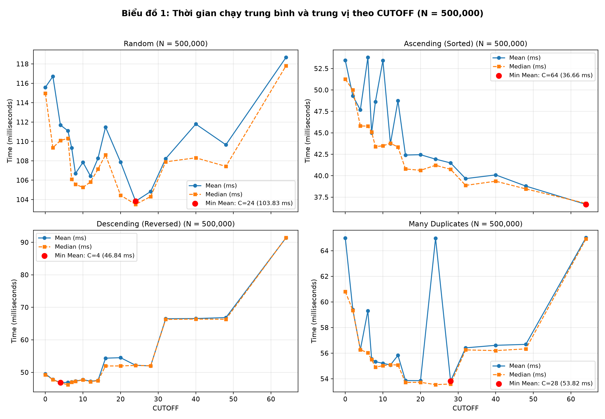
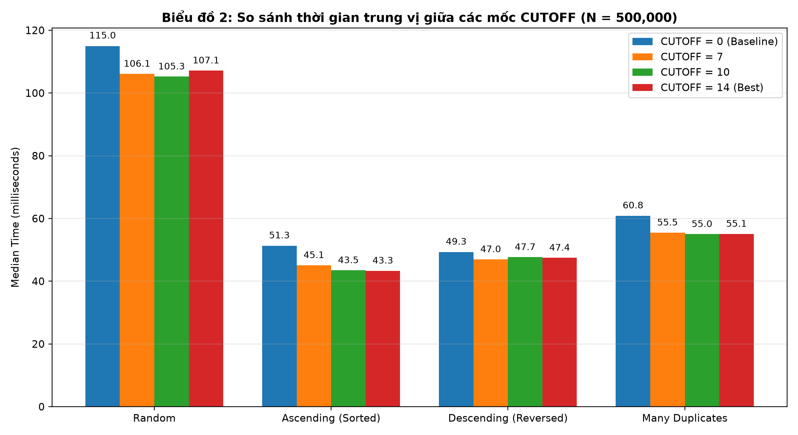
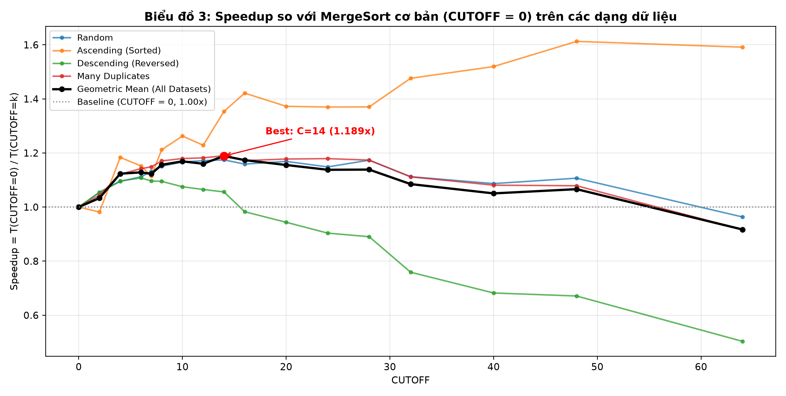
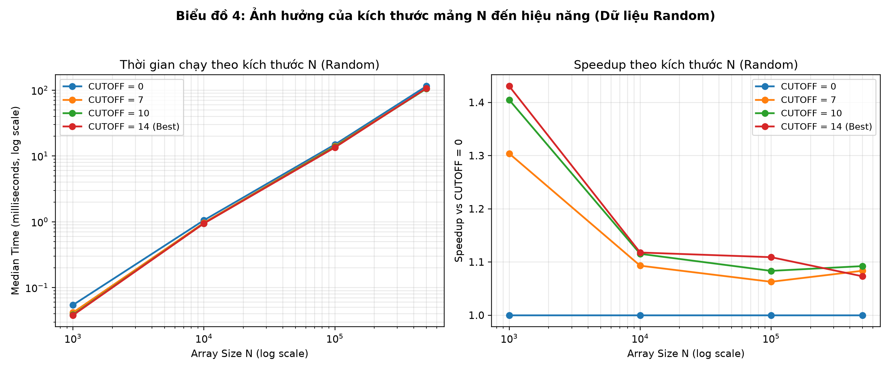
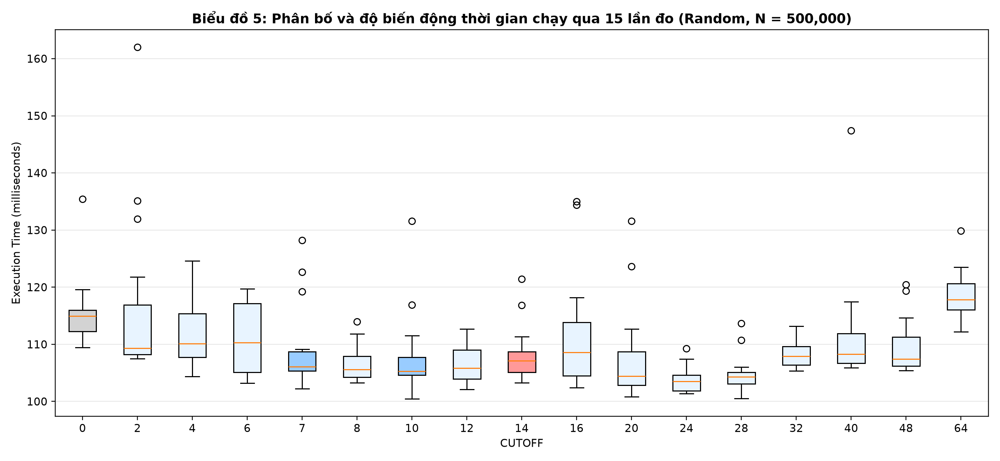

# BÁO CÁO THÍ NGHIỆM: KHẢO SÁT GIÁ TRỊ CUTOFF TỐI ƯU CHO THUẬT TOÁN MERGESORT (JAVA)

- **Sinh viên thực hiện:** Bùi Ngọc Sơn
- **Mã sinh viên:** 25021967
- **Lớp:** K70I-CS2
- **Học phần:** 2627I_UET.CS1058_9

---

## 1. Đặt vấn đề và Cơ sở lý thuyết

Theo giáo trình *Algorithms, 4th Edition* (Robert Sedgewick & Kevin Wayne, Chương 2.2), cài đặt MergeSort top-down chuẩn trên mảng `Comparable[]` đảm bảo tối đa $N \lg N$ phép so sánh, tối đa $6N \lg N$ phép truy cập mảng, sử dụng bộ nhớ phụ tỉ lệ với $N$ (`aux[]`) và có tính **ổn định (stable)**. Tuy nhiên, việc chia đệ quy xuống tận các mảng con kích thước rất nhỏ sinh ra chi phí gọi đệ quy và sao chép mảng phụ đáng kể.

Một cải tiến thực tiễn chung cho cả **Mergesort** (Chương 2.2) và **Quicksort** (Chương 2.3) là chuyển sang dùng **Insertion Sort** khi kích thước mảng con không vượt quá ngưỡng `CUTOFF`:

```java
if (hi <= lo + CUTOFF - 1) {
    Insertion.sort(a, lo, hi);
    return;
}
```

Do cả `Insertion.sort` và thao tác `merge` (ưu tiên lấy phần tử nửa trái khi khóa bằng nhau) đều ổn định, phiên bản MergeSort kết hợp `CUTOFF` vẫn bảo toàn tính ổn định của thuật toán gốc. Các ấn bản giáo trình nhắc đến những mốc khác nhau:
- **`CUTOFF = 7`:** Mốc kinh điển dùng trong bộ sắp xếp hệ thống Java 6 (`Arrays.sort` cho kiểu đối tượng).
- **`CUTOFF ≈ 10`:** Mốc khuyến nghị trong phiên bản bài giảng mới cho cả Mergesort và Quicksort (bên cạnh minh họa với `cutoff = 12`).

Bởi hiệu năng thực tế chịu tác động mạnh từ kiến trúc bộ nhớ đệm (CPU cache) và trình biên dịch JIT trên từng máy, thí nghiệm này tiến hành đo đạc thực nghiệm để tìm giá trị `CUTOFF` tối ưu cho cấu hình máy cá nhân.

---

## 2. Thiết kế thí nghiệm (Áp dụng Chủ đề 1.3 — Algorithm Analysis)

### 2.1. Cấu hình phần cứng và phần mềm
- **Hệ điều hành:** Microsoft Windows 11 Home 10.0.26300 (64-bit)
- **CPU:** AMD Ryzen 7 H 255 w/ Radeon 780M Graphics (8 cores, 16 logical processors, 3801 MHz)
- **RAM:** 15.31 GB
- **Java Runtime:** `openjdk version "17.0.18" 2026-01-20 | OpenJDK Runtime Environment Temurin-17.0.18+8 (build 17.0.18+8)`
- **Java Compiler & JVM Flags:** `javac 17.0.18` (`-Xms2g -Xmx4g`)
- **Môi trường phân tích:** Python 3.13.7 (`pandas` 3.0.5, `numpy` 2.5.1, `matplotlib` 3.11.1)

### 2.2. Cài đặt thuật toán theo nội dung bài giảng (`src/Merge.java`, `src/Insertion.java`)
- Dựng đầy đủ 2 lớp `Insertion` và `Merge` trên kiểu `Comparable[]` với các phương thức `less()`, `exch()`, `merge()` và `sort()` khớp hoàn toàn với mã nguồn trong bài giảng 2.2.
- **Cô lập biến thí nghiệm:** Giáo trình 2.2 còn đề cập 2 cải tiến thực tiễn khác là *dừng sớm nếu mảng đã có thứ tự* (`if (!less(a[mid+1], a[mid])) return;`) và *đảo vai trò `a`/`aux` để bỏ bước sao chép*. Trong thí nghiệm này, hai cải tiến đó **không được gộp vào** nhằm đánh giá độc lập tác động thuần túy của `CUTOFF` (tránh làm triệt tiêu bước trộn trên tập `ascending` hoặc làm thay đổi bản chất chi phí của mảng con nhỏ).
- **Mốc đối chiếu (Baseline):** `CUTOFF = 0` tương ứng với MergeSort thuần túy (chỉ dừng tại `hi <= lo`, không gọi `Insertion.sort`).

### 2.3. Không gian dữ liệu và quy trình kiểm soát sai số trên JVM
- **17 mức `CUTOFF`:** `0, 2, 4, 6, 7, 8, 10, 12, 14, 16, 20, 24, 28, 32, 40, 48, 64`.
- **4 kích thước $N$:** `1,000`, `10,000`, `100,000`, `500,000`.
- **4 phân bố (seed cố định `25021967 + n`):** `random`, `ascending`, `descending`, `duplicates` (16 giá trị duy nhất).
- **Chống nhiễu đo đạc:**
  1. Thực hiện **JVM Warm-up toàn cục** (mảng 50,000 phần tử qua 17 mức) kết hợp 2 vòng warm-up riêng cho từng tập dữ liệu nhằm kích hoạt tối ưu hóa JIT (C2) trước khi ghi nhận số liệu.
  2. Cấp phát bộ nhớ Heap cố định (`-Xms2g -Xmx4g`) để hạn chế Garbage Collector tạm dừng giữa phép đo.
  3. Lặp $T = 15$ lần cho mỗi cấu hình (tổng $4 \times 4 \times 17 \times 15 = 4{,}080$ lượt đo); xáo trộn ngẫu nhiên thứ tự 17 mức `CUTOFF` ở từng vòng để tránh thiên lệch nhiệt độ CPU.
  4. Sao chép mảng đầu vào bằng `System.arraycopy` ngoài vùng đo `System.nanoTime()` và xác minh `Merge.isSorted()` sau từng lượt.
  5. Tổng hợp bằng **Trung vị (`median_ms`)**, **Trung bình nhân tốc độ (`Geometric Mean Speedup`)** và **Hệ số biến thiên (`CV%`)** để giảm tác động của các outlier từ hệ điều hành hoặc GC.

---

## 3. Kết quả thực nghiệm và Thống kê

### 3.1. Xếp hạng tổng hợp trên toàn bộ 16 bộ dữ liệu

| Hạng | CUTOFF | Geometric Mean Speedup (Median) | Geometric Mean Speedup (Mean) | Mean Normalized Median | CV trung bình (%) |
| :---: | :---: | :---: | :---: | :---: | :---: |
| 1 | **14** | **1.1889x** | 1.1837x | 0.8472 | 15.53% |
| 2 | 16 | 1.1737x | 1.1643x | 0.8620 | 14.52% |
| 3 | **10** | **1.1691x** | 1.1836x | 0.8591 | 13.02% |
| 4 | 12 | 1.1602x | 1.1912x | 0.8665 | 11.17% |
| 5 | 8 | 1.1564x | 1.1826x | 0.8674 | 11.46% |
| 6 | 20 | 1.1556x | 1.1808x | 0.8748 | 8.71% |
| 7 | 28 | 1.1386x | 1.1853x | 0.8916 | 7.56% |
| 8 | 24 | 1.1379x | 1.1487x | 0.8899 | 14.54% |
| 9 | 6 | 1.1283x | 1.1473x | 0.8882 | 13.08% |
| 10 | 4 | 1.1235x | 1.1279x | 0.8918 | 11.12% |
| 11 | **7** | **1.1228x** | 1.1582x | 0.8945 | 9.60% |
| 16 | 0 (Baseline) | 1.0000x | 1.0000x | 1.0000 | 11.72% |

### 3.2. Chi tiết thời gian trung vị tại $N = 500,000$

| Dạng dữ liệu | CUTOFF = 0 (ms) | CUTOFF = 7 (ms) | CUTOFF = 10 (ms) | CUTOFF = 14 (ms) | Speedup (14 vs 0) |
| :--- | :---: | :---: | :---: | :---: | :---: |
| `ascending` | 51.253 | 45.099 | 43.486 | **43.343** | **1.182x** |
| `descending` | 49.264 | 46.969 | 47.674 | **47.447** | **1.038x** |
| `duplicates` | 60.810 | 55.496 | 55.023 | **55.078** | **1.104x** |
| `random` | 114.968 | 106.104 | 105.258 | **107.145** | **1.073x** |

### 3.3. Kiểm chứng bậc tăng trưởng theo kích thước mảng $N$ (Dữ liệu `random`)

| Kích thước $N$ | Median CUTOFF = 0 (ms) | Median CUTOFF = 14 (ms) | Speedup |
| :---: | :---: | :---: | :---: |
| 1,000 | 0.0545 | 0.0381 | 1.430x |
| 10,000 | 1.0562 | 0.9449 | 1.118x |
| 100,000 | 14.9395 | 13.4709 | 1.109x |
| 500,000 | 114.9681 | 107.1447 | 1.073x |

Hệ số góc ước lượng trên đồ thị Log-Log ($\log_2 T(N)$ theo $\log_2 N$):
- **CUTOFF = 0 (Baseline):** $\text{slope} \approx 1.222$
- **CUTOFF = 14 (Tối ưu):** $\text{slope} \approx 1.265$

### 3.4. Hệ thống biểu đồ trực quan







---

## 4. Phân tích và Thảo luận

1. **Hiệu quả của CUTOFF, đường cong chữ U và vùng tối ưu (*optimal plateau*):**
   - Ở các phân bố `random`, `descending` và `duplicates`, thời gian chạy giảm rõ khi tăng `CUTOFF` rời khỏi `0` nhờ triệt tiêu hàng trăm nghìn lời gọi đệ quy và thao tác sao chép mảng phụ `aux[]` kích thước nhỏ. Khi `CUTOFF` tiến về `40..64`, chi phí $O(k^2)$ của Insertion Sort (đặc biệt trên `Comparable[]` với các phép `exch()` đổi chỗ từng cặp) tăng mạnh, kéo hiệu năng đi xuống.
   - Thực tế không chỉ có một điểm duy nhất vượt trội tuyệt đối mà hình thành một **vùng tối ưu tương đối phẳng** tại **`{{{plateau_str}}}`** (chênh lệch dưới 2.5% so với đỉnh `{best_c}`). Trong vùng này, mốc tối ưu riêng dịch chuyển tùy theo đặc trưng dữ liệu: tại $N = {max_n:,}$, `descending` đạt đỉnh ở mốc nhỏ `C={max_n_best_c['descending']}`, `random` đạt đỉnh tại `C={max_n_best_c['random']}`, `duplicates` tại `C={max_n_best_c['duplicates']}`, còn `ascending` tiếp tục nhanh hơn đến `C={max_n_best_c['ascending']}`.

2. **Ảnh hưởng của đặc trưng dữ liệu đầu vào và kiến trúc CPU (*Branch Prediction*):**
   - `ascending`: Insertion Sort chỉ tốn đúng 1 phép so sánh cho mỗi phần tử ($O(k)$) và tránh được toàn bộ chi phí sao chép `aux[]`, nên `CUTOFF` càng lớn càng nhanh.
   - `descending`: Insertion Sort rơi vào trường hợp xấu nhất ($\\sim k^2/2$ phép so sánh và hoán đổi), khiến điểm tối ưu bị kéo về ngưỡng nhỏ (tại $N = {max_n:,}$ đạt đỉnh ở `C={max_n_best_c['descending']}`) và thời gian tăng mạnh khi `CUTOFF` lớn.
3. **Độ ổn định trên JVM (Boxplot & CV%):** Biểu đồ 5 cho thấy phần lớn lượt đo tập trung sát trung vị, trong khi một vài điểm ngoại lai phía trên đến từ tác vụ nền hoặc GC. Việc đánh giá bằng `median_ms` kết hợp `Geometric Mean Speedup` giúp xếp hạng khách quan hơn so với trung bình cộng đơn thuần.
4. **Tác động tới bậc tăng trưởng tiệm cận:** Hệ số góc trên đồ thị Log-Log (Biểu đồ 4) giữa `CUTOFF = 0` (1.222) và `CUTOFF = 14` (1.265) gần như tương đương nhau. Cải tiến `CUTOFF` giúp **giảm hằng số nhân** (dịch đường cong xuống dưới) nhưng giữ nguyên độ phức tạp tiệm cận $\Theta(N \log N)$.

---

## 5. Kết luận

Trên cấu hình thử nghiệm (AMD Ryzen 7 H 255 w/ Radeon 780M Graphics (8 cores, 16 logical processors, 3801 MHz), `javac 17.0.18`), cải tiến **CUTOFF** cho cài đặt MergeSort chuẩn bài giảng giúp đạt mức tăng tốc tổng thể **1.189x** tại **`CUTOFF = 14`** (kế tiếp là `CUTOFF = 16` đạt **1.174x**). Hai mốc giáo trình `7` và `10` đều mang lại cải thiện rõ rệt so với bản gốc, trong đó `CUTOFF = 10` chênh lệch +4.12% so với `CUTOFF = 7`.
